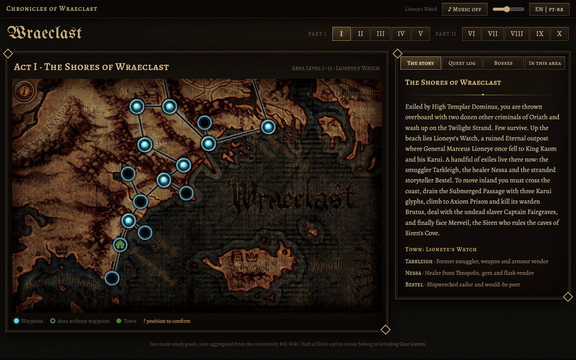
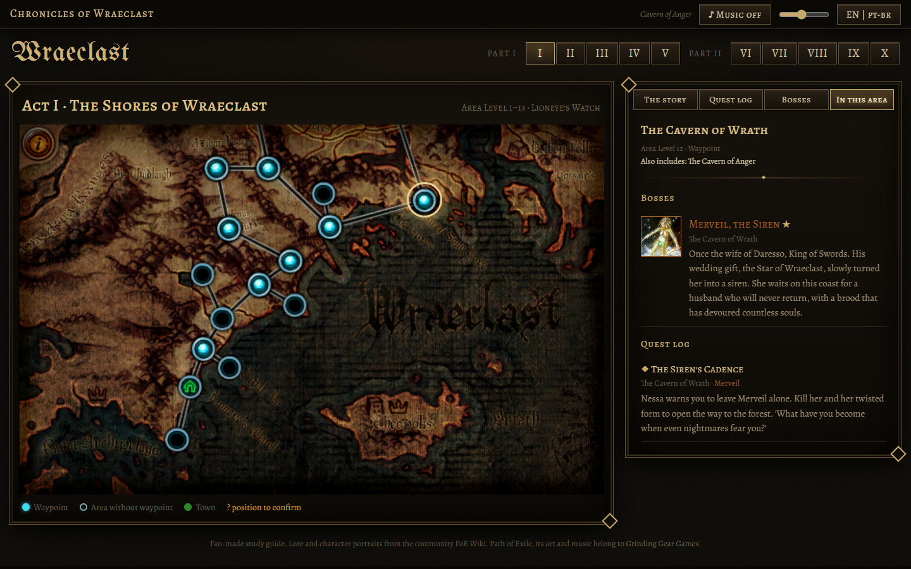
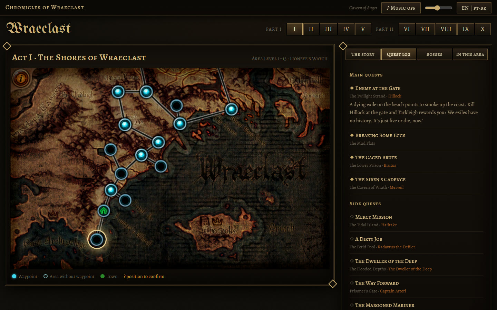

<p align="center">
  
</p>

<h1 align="center">Chronicles of Wraeclast</h1>

<p align="center">
  An interactive guide to the <b>Path of Exile</b> story, presented as the game's own waypoint world screen.<br>
  <b>English</b> · <a href="README.pt-BR.md">Português (Brasil)</a>
</p>

---

## About

Path of Exile has a deep story that most players miss while they run through the campaign. This site explains it through what players already recognize: the **official waypoint map of each act**. Click an area to see who lives there, which quests happen there, which bosses you fight and why they matter.

It was made with Brazilian players in mind, so the whole interface and every text are available in **English and Brazilian Portuguese**. Game names (areas, quests, bosses) stay in English, as they appear in the game.

## Features

- **Parts I and II, acts I–X**, using each act's official waypoint map with clickable area nodes.
- **Item-style tooltips** on each area: area level, waypoint, town, connected areas and bosses.
- **Side panel** for each act: the story, the quest log (main and side quests), the bosses and their lore, and an *In this area* view for the selected node.
- **Per-area soundtrack** with crossfade (optional, see [Music](#music-optional)). Music starts only after you turn it on.
- **EN / PT-BR** toggle, remembered by the browser. The selected act and area live in the URL (`/act/2?area=1_2_14_2`), so you can share a direct link.
- Keyboard: `←` / `→` move between acts.

## Screenshots

| World map and story | Area selected | Quest log |
| --- | --- | --- |
|  |  |  |

## Run it on your machine

### Requirements

- [Node.js](https://nodejs.org/) **22.12 or newer** (developed and tested on Node 24). Vite 8 requires `^20.19.0 || >=22.12.0`.
- [Git](https://git-scm.com/).

### Steps

```bash
git clone https://github.com/edilsonvilarinho/lore-path-of-exile.git
cd lore-path-of-exile
npm install
npm run dev
```

Open **http://localhost:5173**.

`npm run dev` starts two processes:

| Process | Address | What it does |
| --- | --- | --- |
| API (Express) | http://127.0.0.1:3000 | Serves `/api/*`, the maps and the music |
| Client (Vite) | http://localhost:5173 | Vue app with hot reload; forwards `/api`, `/audio`, `/assets/maps` and `/assets/portraits` to the API |

### Production build

```bash
npm run build   # builds the client into client/dist
npm start       # Express serves the API and the built site
```

Open **http://127.0.0.1:3000**.

| Variable | Default | Purpose |
| --- | --- | --- |
| `PORT` | `3000` | HTTP port |
| `HOST` | `127.0.0.1` | Bind address (`0.0.0.0` to accept outside connections) |
| `AUDIO_DIR` | `server/public/audio` | Folder with the `.mp3` files |
| `PUBLIC_DIR` | `client/dist` | Built client served by Express |

### Music (optional)

The soundtrack is **not** in this repository: it belongs to Grinding Gear Games and is about 551 MB. The site works without it; the music button just stays silent.

If you have the Path of Exile soundtrack as MP3 files, point the copy script to the folder that contains these two subfolders:

```
<your folder>/
├── Path of Exile (Original Game Soundtrack)/
└── Extended Soundtrack/
    ├── Core Game/
    └── Expansions/   (Abyss, Delve, Atlas of Worlds, …)
```

```bash
npm run copy:audio -- "/path/to/your/folder"
```

The script copies only the 65 tracks used by the site to `server/public/audio/` and lists any file it cannot find. The exact expected file names are in the `src` field of `tracks` in `data/lore.json` and `data/campaign/tracks.json`.

### Deploy with Docker / Dokploy

`Dockerfile.dokploy` builds one container that serves everything on port `3000`, with a healthcheck at `/api/health`.

```bash
docker build -f Dockerfile.dokploy -t lore-poe .
docker run --rm -p 3000:3000 -v "$PWD/server/public/audio:/audio:ro" lore-poe
```

In Dokploy: Build Type **Dockerfile**, Dockerfile Path `Dockerfile.dokploy`, Docker Context Path `.`, port `3000`. Mount the folder with the MP3 files on `/audio`.

## Project structure

```
client/            Vue 3 + Vite + vue-router + Pinia + vue-i18n
  src/views/       WorldView: the waypoint world screen
  src/components/  ActMap, SidePanel, QuestItem, BossItem, Portrait, AreaTooltip, TopBar
  src/stores/      campaign data and audio (crossfade)
server/src/        Express 5: /api/campaign, /api/lore, /api/health, static maps, portraits, audio and client
data/              lore.json (eras, figures), campaign/act1..10.json (nodes, quests, bosses) and portraits.json
assets/maps/       official waypoint maps
assets/portraits/  boss and NPC portraits (200 px) from the PoE Wiki
scripts/           build-campaign, fetch-portraits, copy-audio, capture-screens
```

| Command | What it does |
| --- | --- |
| `npm run build:campaign` | Merges `data/campaign/act*.json` into `data/campaign.json` and checks every reference (tracks, maps, quest and boss areas, portraits) |
| `npm run fetch:portraits` | Downloads the portraits listed in `data/portraits.json` (slug → PoE Wiki file) into `assets/portraits/`; skips existing files, `--force` re-downloads |
| `npm run copy:audio -- <dir>` | Copies the soundtrack used by the site |
| `npm run capture` | Regenerates the README images and GIFs in `docs/media` (needs the app running, Google Chrome and `ffmpeg`) |

## Data accuracy

The map node positions follow the official waypoint images. A few nodes were placed from area connections and are not yet confirmed in game. They show a `?` on the map and a warning in the panel. Corrections from players are welcome: open an issue.

## Credits and license

- Lore text is summarized and translated from the community [Path of Exile Wiki](https://www.poewiki.net), licensed [CC BY-NC-SA 3.0](https://creativecommons.org/licenses/by-nc-sa/3.0/). The derived text in `data/` is shared under the same license. Boss and NPC portraits in `assets/portraits/` are in-game screenshots hosted by the PoE Wiki.
- Path of Exile, its maps, art and music are the intellectual property of **Grinding Gear Games**. This is an unofficial fan project, not affiliated with or endorsed by Grinding Gear Games.
- Source code: [MIT](LICENSE).
