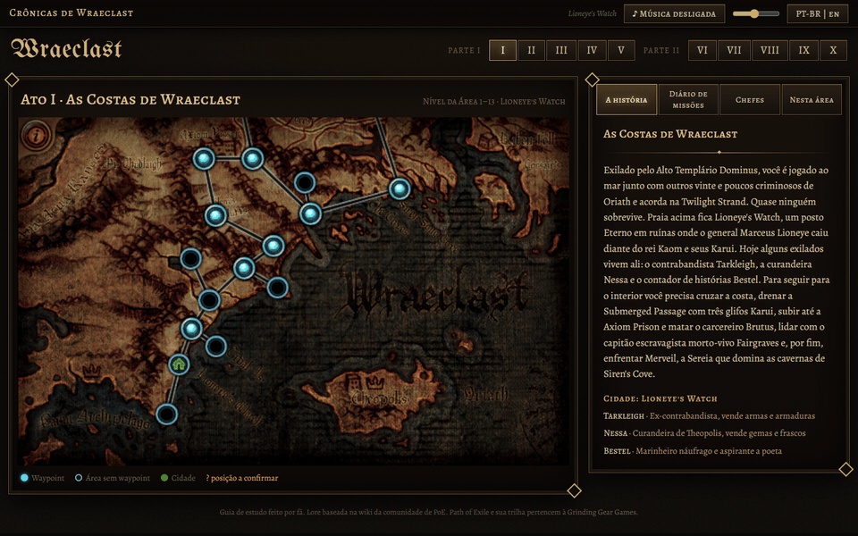
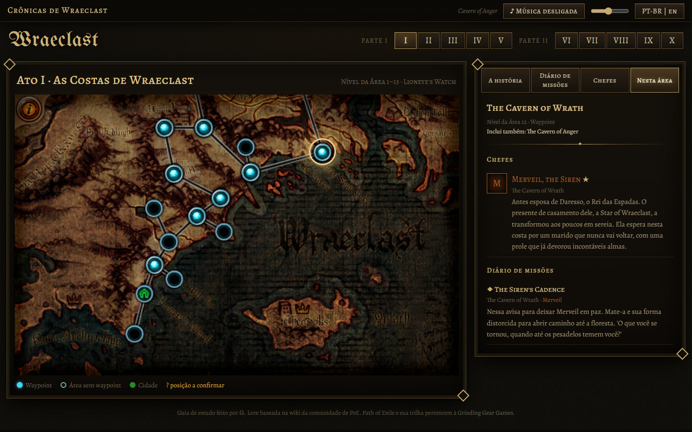
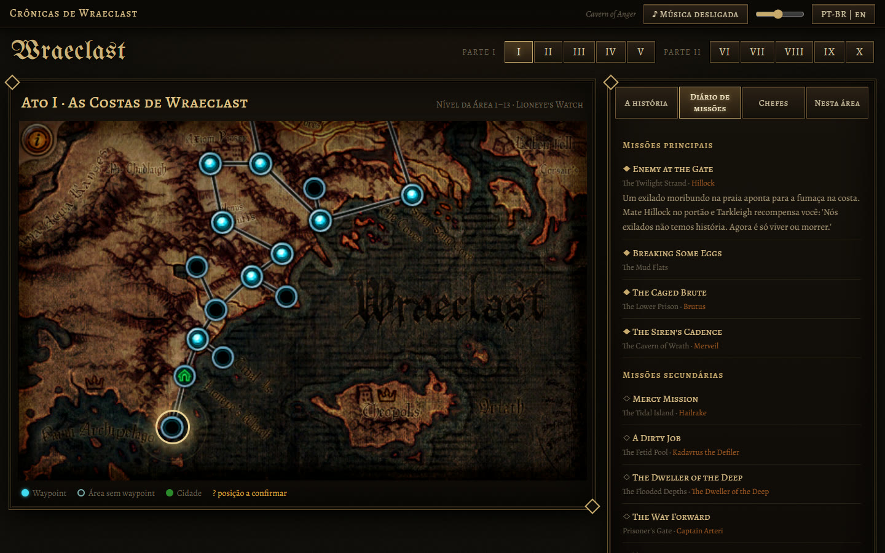

<p align="center">
  
</p>

<h1 align="center">Crônicas de Wraeclast</h1>

<p align="center">
  Um guia interativo da história de <b>Path of Exile</b>, apresentado na própria tela de waypoints do jogo.<br>
  <a href="README.md">English</a> · <b>Português (Brasil)</b>
</p>

---

## Sobre

Path of Exile tem uma história profunda que a maioria dos jogadores perde enquanto corre pela campanha. Este site explica essa história a partir do que o jogador já reconhece: o **mapa oficial de waypoints de cada ato**. Clique numa área para ver quem vive ali, quais missões acontecem ali, quais chefes você enfrenta e por que eles importam.

O projeto foi feito pensando no jogador brasileiro: a interface e todos os textos estão em **português do Brasil e inglês**. Nomes do jogo (áreas, missões, chefes) ficam em inglês, como aparecem no jogo.

## Funcionalidades

- **Partes I e II, atos I–X**, com o mapa oficial de waypoints de cada ato e nós de área clicáveis.
- **Tooltips no estilo de item** em cada área: nível da área, waypoint, cidade, áreas incluídas e chefes.
- **Painel lateral** de cada ato: a história, o diário de missões (principais e secundárias), os chefes e a lore deles, e a visão *Nesta área* do nó selecionado.
- **Trilha sonora por área** com crossfade (opcional, veja [Música](#música-opcional)). A música só começa depois que você liga.
- Alternância **PT-BR / EN**, lembrada pelo navegador. O ato e a área selecionados ficam na URL (`/act/2?area=1_2_14_2`), então dá para compartilhar um link direto.
- Teclado: `←` / `→` trocam de ato.

## Capturas de tela

| Mapa do mundo e história | Área selecionada | Diário de missões |
| --- | --- | --- |
|  |  |  |

## Como rodar na sua máquina

### Requisitos

- [Node.js](https://nodejs.org/) **22.12 ou mais novo** (desenvolvido e testado no Node 24). O Vite 8 exige `^20.19.0 || >=22.12.0`.
- [Git](https://git-scm.com/).

### Passo a passo

```bash
git clone https://github.com/edilsonvilarinho/lore-path-of-exile.git
cd lore-path-of-exile
npm install
npm run dev
```

Abra **http://localhost:5173**.

O `npm run dev` sobe dois processos:

| Processo | Endereço | O que faz |
| --- | --- | --- |
| API (Express) | http://127.0.0.1:3000 | Serve `/api/*`, os mapas e as músicas |
| Cliente (Vite) | http://localhost:5173 | App Vue com hot reload; repassa `/api`, `/audio` e `/assets/maps` para a API |

### Build de produção

```bash
npm run build   # gera o cliente em client/dist
npm start       # o Express serve a API e o site compilado
```

Abra **http://127.0.0.1:3000**.

| Variável | Padrão | Função |
| --- | --- | --- |
| `PORT` | `3000` | Porta HTTP |
| `HOST` | `127.0.0.1` | Endereço de escuta (`0.0.0.0` para aceitar conexões de fora) |
| `AUDIO_DIR` | `server/public/audio` | Pasta com os arquivos `.mp3` |
| `PUBLIC_DIR` | `client/dist` | Cliente compilado servido pelo Express |

### Música (opcional)

A trilha sonora **não** está neste repositório: ela pertence à Grinding Gear Games e tem cerca de 551 MB. O site funciona sem ela; o botão de música só fica em silêncio.

Se você tem a trilha sonora de Path of Exile em MP3, aponte o script de cópia para a pasta que contém estas duas subpastas:

```
<sua pasta>/
├── Path of Exile (Original Game Soundtrack)/
└── Extended Soundtrack/
    ├── Core Game/
    └── Expansions/   (Abyss, Delve, Atlas of Worlds, …)
```

```bash
npm run copy:audio -- "/caminho/da/sua/pasta"
```

O script copia só as 65 faixas usadas pelo site para `server/public/audio/` e lista os arquivos que não encontrar. Os nomes exatos esperados estão no campo `src` de `tracks` em `data/lore.json` e `data/campaign/tracks.json`.

### Deploy com Docker / Dokploy

O `Dockerfile.dokploy` gera um único container que serve tudo na porta `3000`, com healthcheck em `/api/health`.

```bash
docker build -f Dockerfile.dokploy -t lore-poe .
docker run --rm -p 3000:3000 -v "$PWD/server/public/audio:/audio:ro" lore-poe
```

No Dokploy: Build Type **Dockerfile**, Dockerfile Path `Dockerfile.dokploy`, Docker Context Path `.`, porta `3000`. Monte a pasta com os MP3 em `/audio`.

## Estrutura do projeto

```
client/            Vue 3 + Vite + vue-router + Pinia + vue-i18n
  src/views/       WorldView: a tela de waypoints do mundo
  src/components/  ActMap, SidePanel, QuestItem, BossItem, AreaTooltip, TopBar
  src/stores/      dados da campanha e áudio (crossfade)
server/src/        Express 5: /api/campaign, /api/lore, /api/health, mapas, áudio e cliente estáticos
data/              lore.json (eras, personagens) e campaign/act1..10.json (nós, missões, chefes)
assets/maps/       mapas oficiais de waypoint
scripts/           build-campaign, copy-audio, capture-screens
```

| Comando | O que faz |
| --- | --- |
| `npm run build:campaign` | Junta `data/campaign/act*.json` em `data/campaign.json` e valida todas as referências (faixas, mapas, áreas de missões e chefes) |
| `npm run copy:audio -- <pasta>` | Copia a trilha sonora usada pelo site |
| `npm run capture` | Regenera as imagens e GIFs do README em `docs/media` (precisa do app rodando, Google Chrome e `ffmpeg`) |

## Precisão dos dados

As posições dos nós seguem as imagens oficiais de waypoint. Alguns nós foram posicionados pelas conexões entre áreas e ainda não foram confirmados no jogo. Eles aparecem com `?` no mapa e com um aviso no painel. Correções de jogadores são bem-vindas: abra uma issue.

## Créditos e licença

- Os textos de lore são resumidos e traduzidos da [Path of Exile Wiki](https://www.poewiki.net) da comunidade, licenciada em [CC BY-NC-SA 3.0](https://creativecommons.org/licenses/by-nc-sa/3.0/deed.pt_BR). O texto derivado em `data/` é compartilhado sob a mesma licença.
- Path of Exile, seus mapas, artes e músicas são propriedade intelectual da **Grinding Gear Games**. Este é um projeto de fã não oficial, sem vínculo nem endosso da Grinding Gear Games.
- Código-fonte: [MIT](LICENSE).
